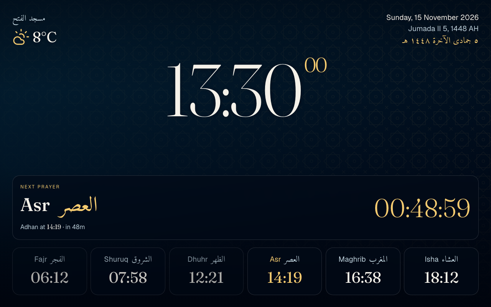
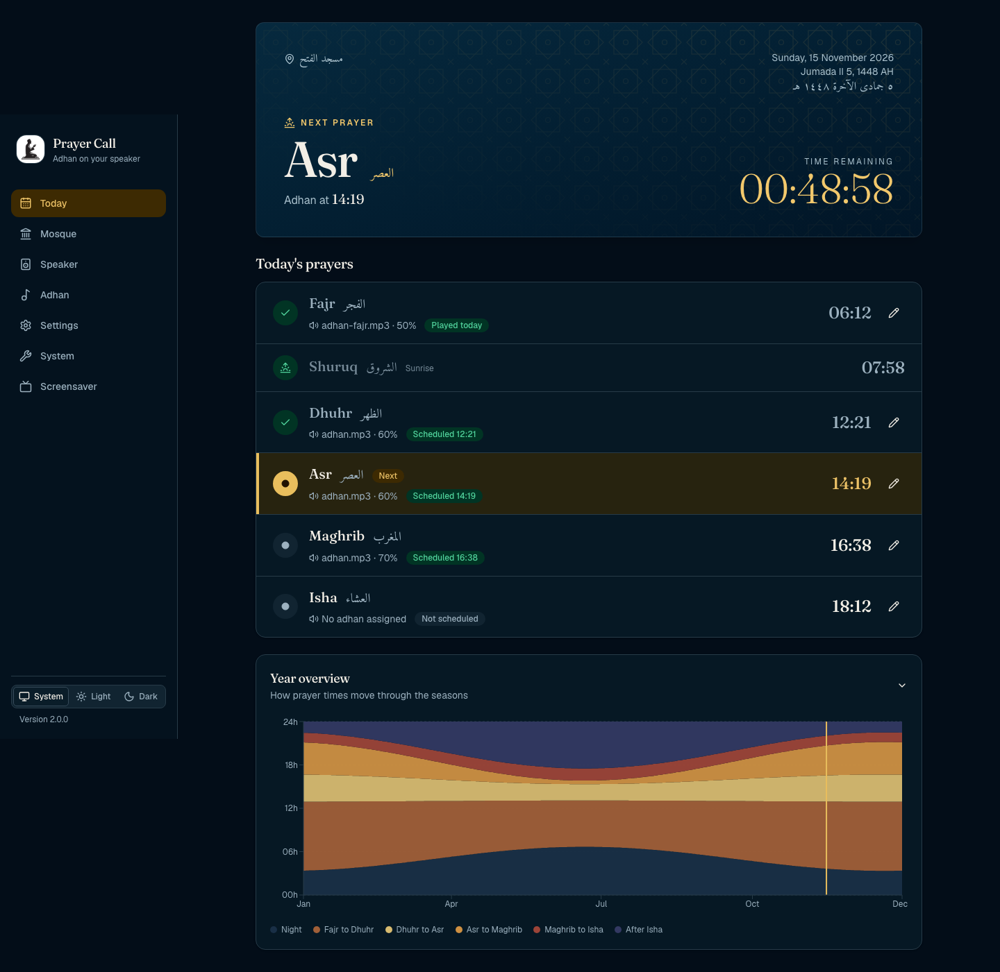
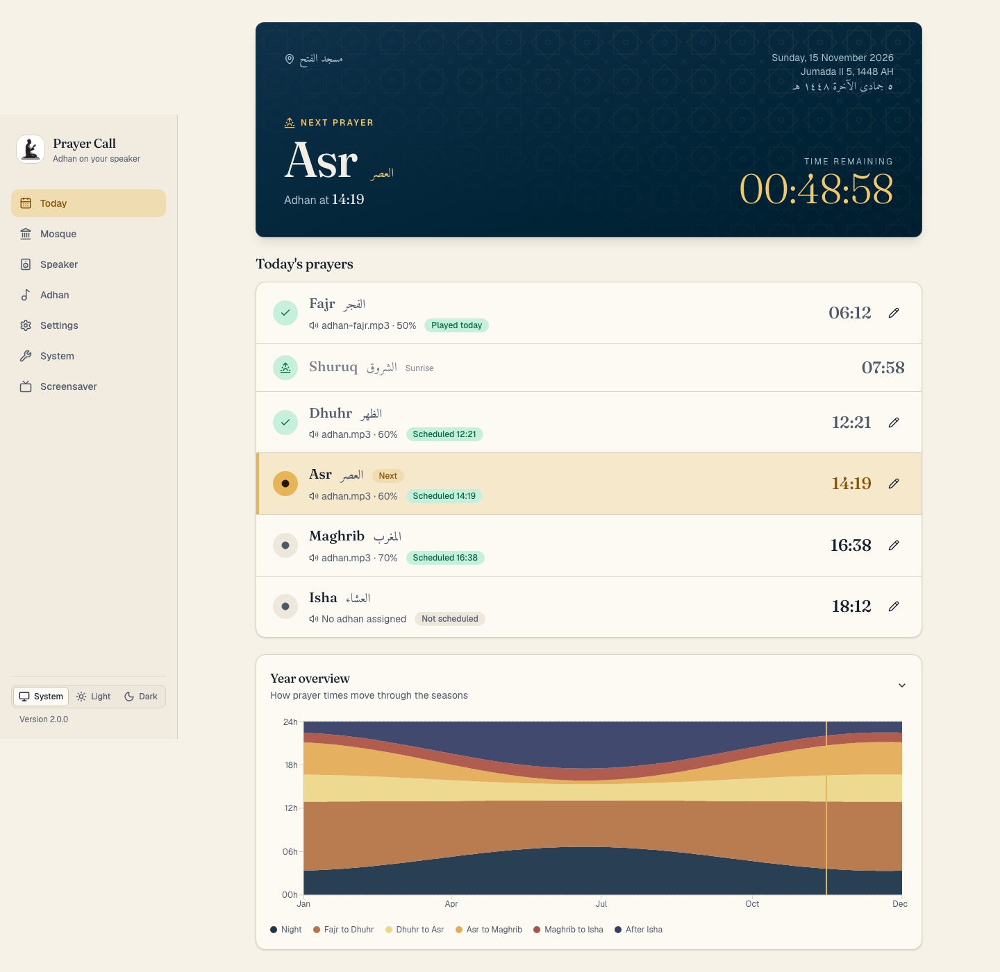
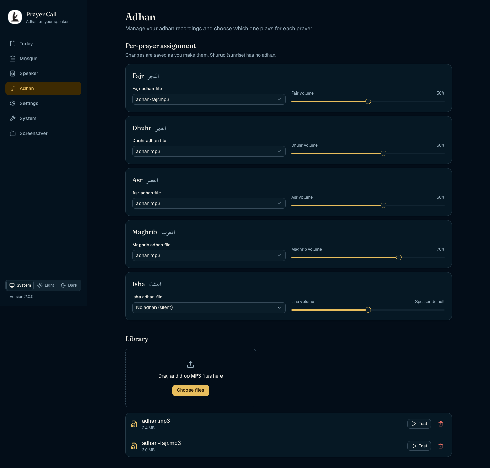
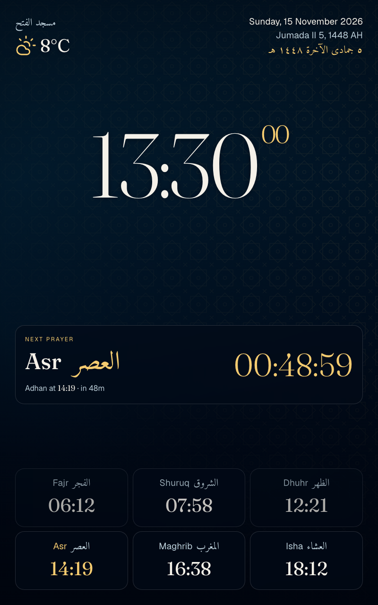

# Prayer Call



Prayer Call schedules adhan (prayer call) on Chromecast devices. A Flask backend
reads prayer times for a Mawaqit mosque, schedules one system cron job per adhan
prayer, and plays the configured MP3 on the chosen Chromecast at prayer time. A
React (Vite) single-page app manages it. Version 2.0.0.

## Features

- **Today**: today's prayer times, including shuruq (display only, never played).
- **Mosque**: search Mawaqit mosques and select one.
- **Speaker**: scan the local network for Chromecasts, select one, send a test play.
- **Adhan**: upload MP3 files, assign a file and volume to each prayer, view and clear cron jobs and their logs.
- **Settings**: application configuration, including the screensaver weather.
- **System**: system status and version.
- **Screensaver** (`/screensaver`): full-screen photo slideshow from Unsplash,
  with optional live weather (icon and temperature). Weather providers:
  [Open-Meteo](https://open-meteo.com) (no key needed),
  [OpenWeatherMap](https://openweathermap.org/api) and
  [WeatherAPI.com](https://www.weatherapi.com) (API key needed). Set the provider,
  units and location in Settings.

## Screenshots

| Today (dark) | Today (light) |
| --- | --- |
|  |  |
| **Adhan** | **Screensaver (portrait)** |
|  |  |

Screenshots come from the Playwright suite (`cd frontend && bun run test:e2e`),
which writes them to `frontend/e2e/screenshots/`.

## Quick start (local development)

Prerequisites: Python 3.12+, [bun](https://bun.sh) 1.4.4 (pinned in `frontend/package.json`).

Backend, in a virtual environment on port 3001:

```bash
python3 -m venv .venv
source .venv/bin/activate
pip install -r requirements-dev.txt
mkdir -p uploads
FLASK_DEBUG=1 python -m backend.app
```

Frontend, in a second shell, on port 3000 (Vite proxies `/api` to `localhost:3001`):

```bash
cd frontend
bun install
bun run dev
```

`./start.sh` does both. The dev backend binds `127.0.0.1` and does not schedule
cron jobs at startup. Chromecasts cannot fetch adhan files from it, so test
playback from a real device needs the Docker or Kubernetes setup below.

## Configuration

Settings are read from environment variables. The app's own settings live in
`config.json` inside `CONFIG_DIR`, managed through the Settings and Mosque/Speaker/Adhan pages.

| Variable | Default | Purpose |
| --- | --- | --- |
| `PORT` | `3001` | HTTP port for gunicorn and the dev server. Also used for the media URL and the Docker healthcheck. |
| `CONFIG_DIR` | project root (image: `/app/config`) | Directory holding `config.json`. |
| `UPLOAD_DIR` | `<project root>/uploads` (image: `/app/uploads`) | Directory holding uploaded adhan MP3 files. |
| `LOG_DIR` | `/var/log` (image: `/app/logs`) | Directory for per-prayer cron logs (`prayer-call-<key>.log`). |
| `PUBLIC_URL` | unset | Base URL the Chromecast uses to fetch adhan files. If unset, `http://<local IP>:<PORT>` is used. |
| `TZ` | `UTC` | Timezone for cron and prayer times. An unknown value falls back to UTC. Example: `Europe/Amsterdam`. |
| `CORS_ORIGINS` | `http://localhost:3000,http://127.0.0.1:3000` | Comma-separated origins allowed for `/api/*`. |
| `UNSPLASH_ACCESS_KEY` | unset | Unsplash key for the screensaver. A key saved in `config.json` takes precedence. |
| `LOG_LEVEL` | `INFO` | Python logging level. |
| `FLASK_DEBUG` | unset | Set to `1` to enable the Flask debugger. Only used by `python -m backend.app`, never in the image. |
| `PRAYER_CALL_SKIP_STARTUP` | unset | Set to `1` to skip startup scheduling in `backend.wsgi`. |
| `VITE_API_URL` | `/api` | Frontend build-time API base URL. |

## Docker and Docker Compose

The image is built in two stages: the frontend is built with bun and copied to
`/app/static`, then a `python:3.15-slim` image runs gunicorn with one worker and
8 threads on port 3001. The image installs `cron` and `tzdata`, and the entrypoint
starts cron before gunicorn. The app rewrites the crontab at startup.

```bash
docker build -t prayer-call .
docker compose up -d
docker compose logs -f
```

`docker-compose.yml` bind-mounts `./config`, `./uploads` and `./logs`. It uses
host networking on Linux for Chromecast discovery. On Docker Desktop, use the
port mapping and set `PUBLIC_URL` to a host-reachable address.

The container runs as root because cron must write the crontab and `/etc/localtime`.
The pod or container is the isolation boundary.

## Kubernetes notes

- Use `hostNetwork: true`. Chromecast discovery uses mDNS, and the media URL is built from the host IP unless `PUBLIC_URL` is set.
- Mount persistent volumes at `/app/config`, `/app/uploads` and `/app/logs`. `config.json` and the adhan files must survive restarts.
- Set `TZ` to the mosque's timezone.
- Run a single replica. Scheduling state lives in each container's own crontab, so two replicas would play each adhan twice.
- Liveness and readiness probes can use `GET /healthz` on port 3001. It returns `{"status":"ok","version":"..."}` without network calls.
- Adhan jobs run from the container's system cron, not from Kubernetes CronJobs.

## Testing

Backend (`requirements-dev.txt`):

```bash
ruff check .
ruff format --check .
pytest
```

Frontend (in `frontend/`):

```bash
bun run lint
bun check
bun run test        # Vitest + Testing Library
bun run test:e2e    # Playwright; builds and serves on :4173
bun run build       # bun check, then Vite build into frontend/build
```

Playwright needs its browsers installed once (`bunx playwright install chromium`).

CI runs in `.github/workflows/ci.yml`. The backend job runs ruff and pytest, the
frontend jobs run lint, tests and build, an e2e job runs Playwright, and a docker
job smoke-tests the image and pushes it on `v*` tags.

## API overview

All routes are under `/api` unless noted. Errors are JSON: `{"error": "<message>"}`
with a 4xx or 5xx status. Unknown `/api/*` paths return 404 JSON.

| Method | Path | Purpose |
| --- | --- | --- |
| GET | `/healthz` | Health and version. |
| GET | `/api/version` | Version from the `VERSION` file. |
| GET | `/api/config` | Current configuration. Secrets are never returned. |
| POST | `/api/config` | Partial update with validation. `adhan_files` and `adhan_volumes` are partial merges. |
| GET | `/api/mosques/search?q=` | Search Mawaqit mosques. |
| GET | `/api/mosques/<mosque_id>/prayer-times` | Prayer times for a mosque. |
| GET | `/api/mosques/<mosque_id>/prayer-times/year` | Yearly prayer-time calendar. |
| GET | `/api/chromecasts/scan` | Discover Chromecasts on the network. |
| POST | `/api/test/play` | Test playback on a Chromecast. |
| GET | `/api/files` | List uploaded MP3 files. |
| POST | `/api/files` | Upload an MP3. Returns 409 if the name exists. |
| GET | `/api/files/<filename>` | Serve an MP3 (also the Chromecast media URL). |
| DELETE | `/api/files/<filename>` | Delete an MP3. |
| GET | `/api/cron/jobs` | List scheduled adhan cron jobs. |
| DELETE | `/api/cron/jobs/<prayer>` | Remove one prayer's cron job. |
| GET | `/api/cron/jobs/<prayer>/logs?max_lines=` | Tail a prayer's cron log (1 to 1000 lines). |
| GET | `/api/screensaver/slides` | Shuffled Unsplash photo URLs. |
| GET | `/api/weather/current` | Current weather (cached 10 minutes), or `{"weather": null}` when off. 503 when the provider fails. |
| GET | `/api/weather/providers` | Available weather providers and whether they need a key. |
| GET | `/api/weather/geocode?q=` | Search places for the weather location (Open-Meteo geocoding). |

`GET /api/config` never returns the Mawaqit credentials. It replaces
`unsplash_access_key` with `unsplash_configured: true|false`. `POST /api/config`
still accepts `unsplash_access_key`, and an empty string clears it. Weather
settings live under `weather` (`enabled`, `provider`, `units`, `location`), merged
partially. Weather API keys go in `weather_api_keys` (`{"openweathermap": "..."}`,
an empty string clears one) and come back only as `weather_keys_configured`.

Other routes: `/` and static files are served from the built frontend when it is present.
The SPA also serves `/screensaver` as a standalone page.

## Frontend notes

- Stack: React 19, React Router 8, TanStack Query, Tailwind CSS 4, Recharts, lucide icons, Vite 8.
- Components use `@ui-sdk/react`. Before changing UI, read `frontend/AGENTS.md`. It points to the ui-sdk skill and the docs in `node_modules/@ui-sdk/react/docs/`.
- Path params such as `<filename>` and `<prayer>` must be URL-encoded by the client.
